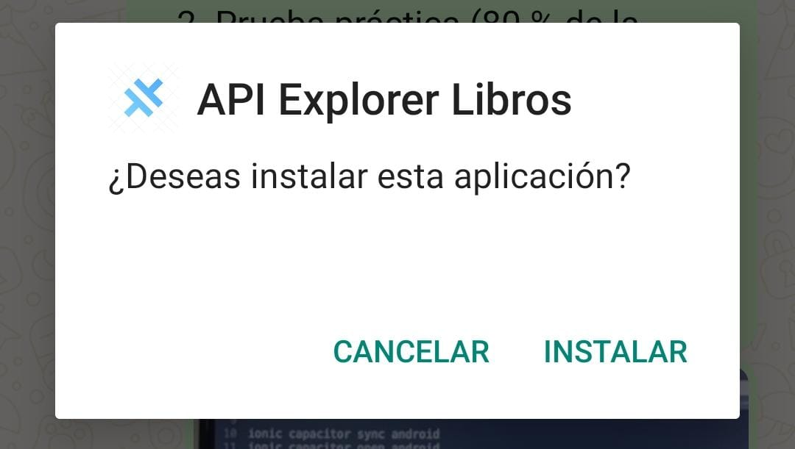
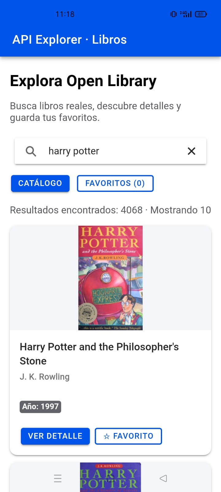
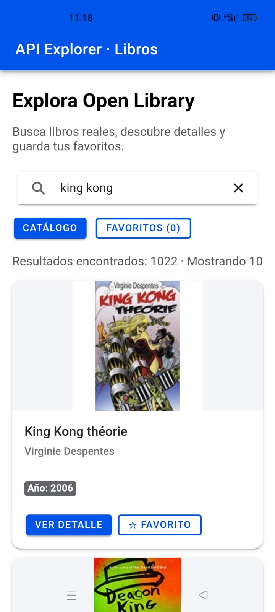
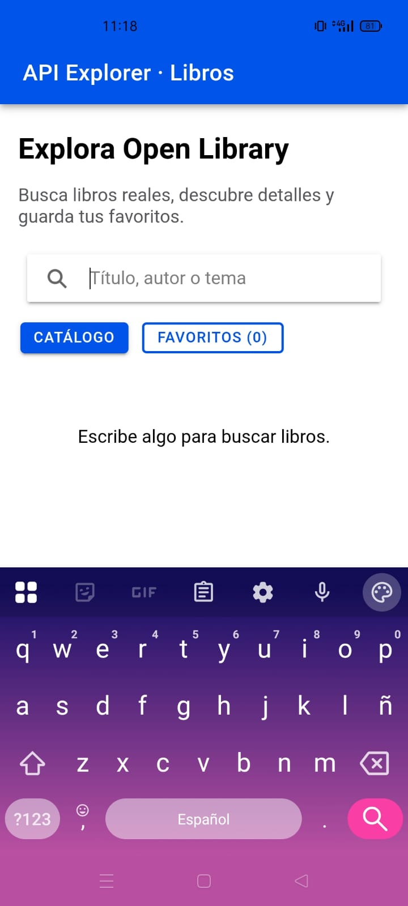

# API Explorer – Libros

Aplicación móvil desarrollada para la materia **Desarrollo de Aplicaciones Móviles** de la ESFOT, utilizando **Ionic, Angular Standalone y Capacitor**. El proyecto consiste en consultar libros de Open Library, buscarlos por título, autor o tema, ver su información y guardar favoritos.

El trabajo se realizó sobre el proyecto `api-libros` que comenzamos en clases. A partir del listado y la búsqueda iniciales, fui completando la navegación, el manejo de errores, la carga de más resultados y el almacenamiento de favoritos.

## ¿Qué hace la aplicación?

Al abrir la aplicación se muestra un catálogo de libros consultado directamente desde **Open Library**. Cada tarjeta presenta el título, autor, año de publicación y la portada cuando existe. Desde el buscador puedo cambiar la consulta y obtener resultados nuevos.

La aplicación incluye:

- **Listado remoto:** los libros se obtienen mediante una petición HTTP GET a Open Library.
- **Búsqueda:** escribo un título, autor o tema y la aplicación solicita el catálogo correspondiente. Si borro el texto, muestra un mensaje para escribir una nueva búsqueda.
- **Infinite scrolling:** utiliza `ion-infinite-scroll` para solicitar la siguiente página y añadir nuevos libros sin repetir identificadores. En cada búsqueda se reinicia la paginación.
- **Detalle del libro:** el botón **Ver detalle** navega a una ruta que contiene el identificador de la obra y consulta sus datos en Open Library.
- **Favoritos:** puedo agregar y quitar libros de una lista local. El proyecto utiliza `localStorage`, una alternativa de almacenamiento persistente permitida en el reto.
- **Estados de pantalla:** se muestran avisos cuando los datos están cargando, cuando la búsqueda está vacía o cuando falla una petición. Las páginas con error se pueden volver a solicitar.

## Capturas de la aplicación en Android

Estas son capturas tomadas durante la ejecución de la aplicación en un teléfono Android el **28 de octubre de 2026**. Se incluyen solamente las que muestran una función o estado identificable.

### Instalación del APK

Se abrió el paquete Android y apareció la confirmación de instalación de **API Explorer Libros**.



### Listado inicial: Harry Potter

La aplicación consulta Open Library y muestra el resultado en tarjetas. En esta búsqueda aparecen **4.068 resultados** reportados por la API, de los que se muestran inicialmente **10**.



### Otra búsqueda: King Kong

Probé otra consulta escribiendo `king kong`. La pantalla mostró los resultados correspondientes y la información de los libros, como título, autor y año.



### Buscador sin texto

Al limpiar el buscador, la aplicación deja de mostrar la consulta anterior e indica que debo escribir algo para buscar libros.



> **Alcance de las evidencias:** estas imágenes muestran la apertura del instalador, la aplicación funcionando en Android, resultados reales de dos búsquedas y el estado del buscador vacío. No se incluyen como prueba una pantalla de detalle todavía cargando ni una captura de favoritos con un contador inconsistente. El código contiene las funciones de detalle, paginación y favoritos, pero las imágenes anteriores no acreditan todas sus pruebas funcionales.

## API utilizada

Utilicé la **API pública de Open Library**, que permite consultar información de obras y buscar libros sin configurar una clave privada para las peticiones utilizadas en este proyecto.

- Documentación: https://openlibrary.org/dev/docs/api/search
- Búsqueda: `GET https://openlibrary.org/search.json`
- Ejemplo: `https://openlibrary.org/search.json?q=harry%20potter&page=1&limit=10`
- Detalle de obra: `GET https://openlibrary.org/works/{id}.json`
- Ejemplo de detalle: `https://openlibrary.org/works/OL45804W.json`
- Portadas: `https://covers.openlibrary.org/b/id/{cover_i}-M.jpg`

La respuesta de búsqueda llega en formato **JSON**. De ella utilizo principalmente `docs`, donde están los libros, y `numFound`, que indica el total de coincidencias reportadas. En cada libro se consultan campos como `key`, `title`, `author_name`, `first_publish_year` y `cover_i`.

### ¿Cómo funciona la paginación?

Open Library permite usar `page` y `limit`. En mi aplicación la primera petición pide `page=1` y `limit=10`. Cuando el usuario llega al final del listado, `ion-infinite-scroll` solicita la siguiente página. Los resultados se agregan al arreglo existente y se comprueba la clave `key` para no mostrar duplicados.

También se controla que no se hagan varias peticiones al mismo tiempo y se utiliza `complete()` para terminar el estado del scroll, incluso si ocurre un error. Cuando la API ya no tiene más registros, se deshabilita la carga adicional.

Al cambiar el texto de búsqueda, se cancela la petición anterior, se borra la lista, se reinicia la página y se vuelve a pedir información. Esto evita mezclar libros de búsquedas distintas.

## Tecnologías

| Tecnología | Uso en el proyecto |
| --- | --- |
| Ionic | Interfaz móvil: tarjetas, botones, buscador e infinite scroll |
| Angular Standalone | Componentes, páginas, navegación y lógica de la aplicación |
| TypeScript | Tipado, interfaces y funciones |
| HttpClient | Peticiones HTTP a Open Library |
| RxJS | Manejo de observables, suscripciones y finalización de consultas |
| Capacitor | Integración con Android y compilación de la aplicación móvil |
| localStorage | Almacenamiento de libros favoritos en el dispositivo |
| Android Studio y Gradle | Construcción e instalación del APK |

## Estructura principal

```text
src/
└── app/
    ├── app.routes.ts
    ├── home/
    │   ├── home.page.ts
    │   ├── home.page.html
    │   └── home.page.scss
    ├── models/
    │   └── book.model.ts
    ├── pages/
    │   └── book-detail/
    │       ├── book-detail.page.ts
    │       ├── book-detail.page.html
    │       └── book-detail.page.scss
    └── services/
        ├── book.ts
        └── favorites.service.ts
```

`book.ts` se encarga de las consultas a la API. `book.model.ts` define los datos que espero recibir. `home.page.ts` controla la búsqueda, los resultados, el scroll y los favoritos; su HTML muestra la interfaz. La carpeta `book-detail` corresponde a la pantalla de información detallada, mientras que `favorites.service.ts` maneja el guardado local.

## Instalación y ejecución

Necesito **Node.js**, **npm** y, para Android, **Android Studio** con el SDK configurado. Para descargar el repositorio:

```cmd
git clone https://github.com/Dilanbkr7/api-libros.git
cd api-libros
npm ci
```

Para probarlo en el navegador:

```cmd
npm start
```

El servidor normalmente se abre en `http://localhost:4200`.

### Compilar y abrir Android Studio

Desde la raíz del proyecto:

```cmd
npm run build
npx cap sync android
npx cap open android
```

Si se trata de una copia nueva que todavía no contiene la carpeta `android/`, primero se agrega la plataforma:

```cmd
npm install @capacitor/android@^8.5.3
npx cap add android
```

`npx cap add android` se utiliza una vez; para futuras modificaciones basta con compilar y sincronizar nuevamente.

### Generar el APK de prueba

Con el Android SDK instalado:

```cmd
cd android
gradlew.bat assembleDebug
```

El resultado se encuentra normalmente en:

```text
android/app/build/outputs/apk/debug/app-debug.apk
```

Es un **APK de depuración** para pruebas y demostración, no una versión firmada para publicación en Google Play. La compilación web y la sincronización de Android se realizaron correctamente en Windows; para generar el APK tuve que configurar la ubicación del SDK de Android.

## Dificultades que encontré

Durante la implementación tuve que entender cómo utilizar los datos que devuelve Open Library y cómo distinguir la información del listado de la información del detalle. También fue importante manejar correctamente el número de página para no repetir datos al desplazarse y reiniciarlo cuando cambia la búsqueda.

Al preparar Android, Gradle inicialmente indicó que no encontraba la ubicación del SDK. Después de configurar Android Studio y la ruta del SDK, se pudo continuar con la construcción y la instalación de la aplicación de prueba.

Otro punto a revisar es la actualización del contador de favoritos en la interfaz. Por ese motivo no tomé esa captura como evidencia de funcionamiento correcto del contador. Asimismo, todavía corresponde comprobar con una captura final que los detalles remotos se carguen completamente.

## Lo que aprendí

El proyecto me permitió practicar la creación de servicios Angular, el uso de `HttpClient`, el manejo de respuestas JSON y la navegación entre páginas. Entendí por qué conviene separar la lógica de las peticiones de la interfaz y cómo se puede conservar información local aunque el catálogo venga de una API externa.

También aprendí el proceso para llevar una aplicación Ionic al teléfono: compilar con Angular, sincronizar con Capacitor, abrir Android Studio y generar un APK con Gradle.

---

**Asignatura:** Desarrollo de Aplicaciones Móviles – ESFOT  
**Proyecto:** Reto práctico API Explorer  
**Repositorio:** https://github.com/Dilanbkr7/api-libros
